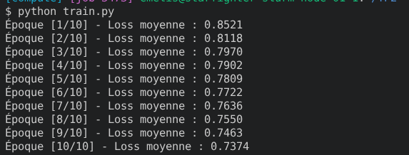
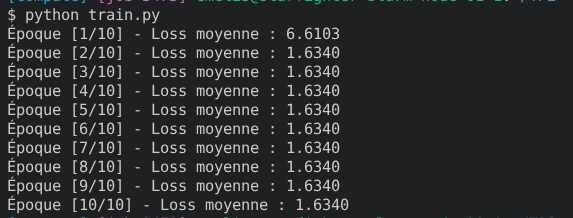
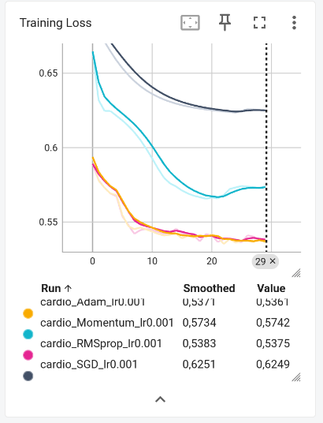
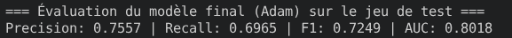

# CI2 : Régularisation, optimisation et métriques

## Exercice 1

1. StandardScaler() sert à normaliser les données d'un jeu de données. Si on le fait avant le split, on le fait sur la totalité des données, donc les informations du jeu de test se retrouvent  utilisées lors de l'entraînement, c'est une fuite de données.
2. torch.utils.data.IterableDataset.

## Exercice 2

  

1. Les lambdas sont petits, c'est-à-dire qu'il y a une petite régularisation. En augmentant les lambdas, on augmente la régularisation. 
Donc la Loss totale a des termes ajoutés beaucoup plus grand, d'où l'augmentation de la loss moyenne qu'on observe sur les captures 
2. weight_decay
3. L1, c'est Lasso, donc il effectue une sélection de variables en forçant plusieurs poids à atteindre exactement zéro. Alors que L2, qui est Ridge, réduit uniformément la valeur absolue de l'ensemble des poids vers zéro sans les annuler complètement, évitant ainsi qu'une seule variable prédomine excessivement. 

## Exercice 3 

1. 

2. Les courbes jaunes et roses convergent le plus vite, elles correspondent respectivement à l'optimiseur d'Adam et à l'optimiseur RMSprop. 

3. La courbe bleu clair correspond au Momentum, elle a une perte de 0.02 à 0.07 inférieure au SGB simple (courbe noire). Le moment permet d'annuler le bruits et les oscillations, et on a une pente raide au début puis la courbe converge. 

## Exercice 4 

1. La précision est la part de prédictions positives qui sont correctes. (precision = TP / (TP + FP)). Le rappel mesure la proportion d'éléments réellement positifs qui ont été correctement identifiés par le modèle. (rappel = TP / (TP + FN))
2. Comme le rappel se concentre sur le fait de détecter toutes les occurrences positives, quitte à faire des erreurs sur les négatives, il est meilleur que la précision dans le cadre médical, car il vaut mieux ne pas rater un positif 
3. La courbe ROC consiste à tracer le taux de vrai positif en fonction du taux de faux positifs. Les autres métriques figent le seuil alors que AUC fait varier la valeur de seuil pour observer comment varient le taux de vrais positifs et le taux de faux positifs à chaque niveau. DOnc elle évalue la performance sur l'ensemble des seuils possibles. 

