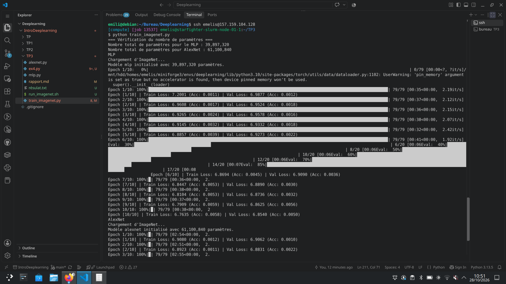
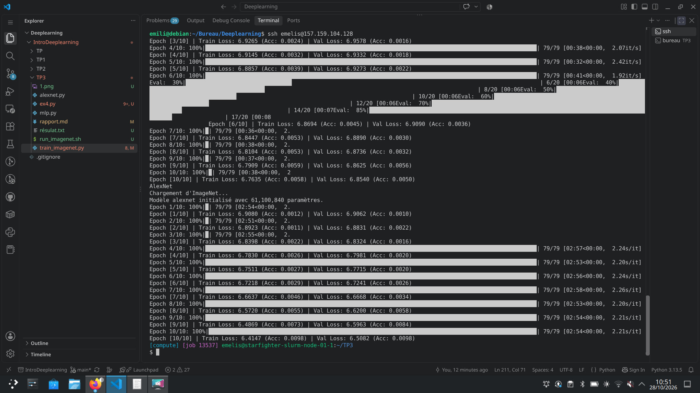

# CI3 : Réseaux convolutifs

## Exercice 1 

### Question 1.1

La descente de gradient oscille fortement sans normalisation. En normalisant on uniformise les valeurs, donc la descente de gradient converge plus rapidement. Mathématiquement, normaliser des valeurs, c'est centrer les valeurs et les diviser par l'écart type. Si on calculait les statistiques sur l'ensemble des valeurs, il y a un risque de fuite des données.  

### Question 1.2

RandomResizedCrop et RandomHorizontalFlip permettent de rendre le modèle plus robuste pendant l'entrainement, mais comme on ne veut pas complexifier les calculs lors de la validation, on n'applique pas le random. 

### Question 1.3

Si on applique RandomHorizontalFlip sur des images avec du texte, le texte ne sera plus lisible. 

## Exercice 2 

 ### Question 2.1 

 Notre modèle MLP a 3 couches. 

1. **Couche 1** 
    * Poids : $3 \times 227 \times 227 \times 256 = 39\,574\,272$
    * Biais : $1 \times 256$
    * **Total Couche 1** = $39\,574\,528$

2. **Couche 2** 
    * Poids : $256 \times 256 = 365\,536$
    * Biais : $1 \times 256$
    * **Total Couche 2** = $65\,792$

2. **Couche 3** 
    * Poids : $256 \times 1000 = 256\,000$
    * Biais : $1 \times 1000$
    * **Total Couche 3** = $257\,000$

Nombre total de paramètres avec le biais : $39\,897\,320$  
Sans le biais : $39\,895\,808$   

La couche 1 concentre 99% des paramètres 

### Question 2.2 

La taille du vecteur obtenu par le flatten est très grande. Par ailleurs on perd la relatiion de voisinage entre les pixels, le modeèle devient sensible aux translations. 

### Question 2.b

| Couche | Taille entrée (C, H×W) | Hyperparamètres (Filtres/Neurones, K, S, P) | Taille sortie (C, H×W) | # Paramètres (avec biais) | Mémoire sortie (KB) |
| --- | --- | --- | --- | --- | --- |
| **Conv1 + ReLU**  | $3, 227 \times 227$ | $64, 11\times11, S=4, P=2$ | $64, 56 \times 56$ | $23\,296$ | $784$ |
| **MaxPool1**  | $64, 56 \times 56$ | $-, 3\times3, S=2, P=0$ | $64, 27 \times 27$ | $0$ | $182,25$ |
| **Conv2 + ReLU**  | $64, 27 \times 27$ | $192, 5\times5, S=1, P=2$ | $192, 27 \times 27$ | $307\,392$ | $546,75$ |
| **MaxPool2**  | $192, 27 \times 27$ | $-, 3\times3, S=2, P=0$ | $192, 13 \times 13$ | $0$ | $126,75$ |
| **Conv3 + ReLU**  | $192, 13 \times 13$ | $384, 3\times3, S=1, P=1$ | $384, 13 \times 13$ | $663\,936$ | $253,5$ |
| **Conv4 + ReLU**  | $384, 13 \times 13$ | $256, 3\times3, S=1, P=1$ | $256, 13 \times 13$ | $884\,992$ | $169$ |
| **Conv5 + ReLU**  | $256, 13 \times 13$ | $256, 3\times3, S=1, P=1$ | $256, 13 \times 13$ | $590\,080$ | $169$ |
| **MaxPool3**  | $256, 13 \times 13$ | $-, 3\times3, S=2, P=0$ | $256, 6 \times 6$ | $0$ | $36$ |
| **Flatten + Dropout**  | $256, 6 \times 6$ | $p = 0.5$ | $9216$ (1D) | $0$ | $36$ |
| **Linear1 + ReLU + Dropout**  | $9216$ | $4096 \text{ neurones } (p=0.5)$ | $4096$ | $37\,752\,832$ | $16$ |
| **Linear2 + ReLU**  | $4096$ | $4096 \text{ neurones}$ | $4096$ | $16\,781\,312$ | $16$ |
| **Linear3 (Sortie)**  | $4096$ | $1000 \text{ classes}$ | $1000$ | $4\,097\,000$ | $3,9$ |

2. L'essentiel des paramètres se concentre à la fin du réseau, car au début du réseau, chaque élément de la sortie ne dépend que d'un sous-ensemble restreint de l'entrée. Alors que lors du flatten, la grille spatiale et tous les canaux restants sont étirés en un unique grand vecteur. La couche linéaire qui suit connecte alors chaque élément de ce grand vecteur à chacun de ses propres neurones.  
L'essentiel de la mémoire des activations se situe dans les premières couches convolutives car en avançant dans le réseau, la taille spatiale des images diminue avce le pooling ou les convolutions avec un stride.

3. Dans l'étape 1, on commence par faire un flatten, donc transformation en un grand vecteur, puis il est transformé en un vectuer de 256 valeurs, puis de nouveau de 256 et enfin 1000. Ces valeurs représentent quelques kilo-octets. Or AlexNet nécessite environ $2340\text{ KB}$ de mémoire d'activation par image. Ce paradoxe s'explique par l'ordre de traitement de l'information spatiale. Le MLP réduit dès le début l'image, tandis que Alexnet, travaille sur plusieurs sous-ensemble des données, e même filtre est appliqué sur tous les points possibles de l'image sans ajouter de paramètres. 

### Question 2.c

Nombre total de paramètres pour le MLP : 39,897,320
Nombre total de paramètres pour AlexNet : 61,100,840

## Exercice 3

### Question 3.a

1. model.eval() désactive le dropout car on est dans les données de validation, donc il faut utiliser tous les neuronnes pour ne pas fausser le résultat. model.train() active le dropout car on est dans les données d'entrainement, le dropout permet de rendre le réseau plus robuste et éviter le sur-apprentissage. Si on oublie model.eval() on aurait des résultats faussés, on aurait des résultats différents entre deux évaluation et comme on utiliserait qu'une partie des neuronnes, on aurait métriques incohérentes. 
2. Accuracy = 1/1000 et perte entropie croisée -ln(1/1000). Le train loss est entre 6.9 et 7.2 ce qui correspond approximativement à -ln(1/100). De même pour l'accuracy, qui est environ égale à 0.001. 

  
3.  Je n'arrive pas à afficher les courbes sur tensor. J'ai mis le dossier runs sur git

