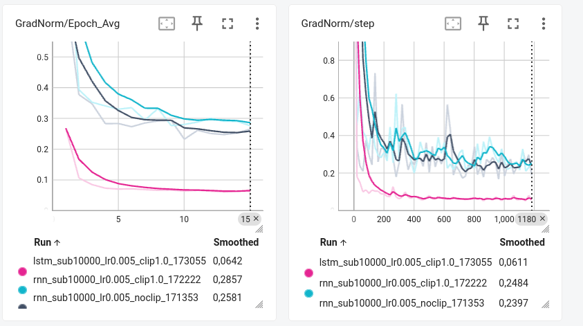
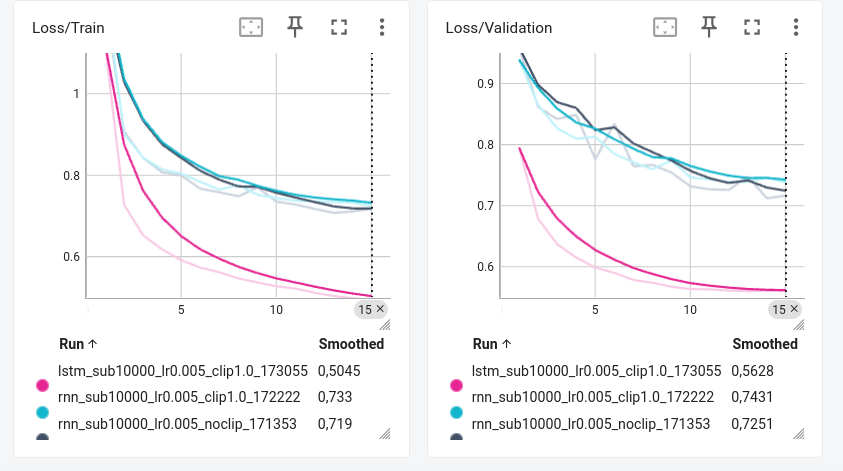
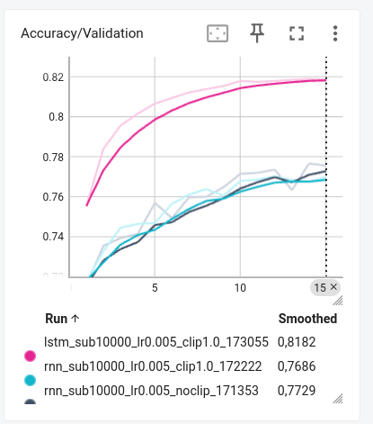

# CI4 : Réseaux récurrents et génération de séquences

## Exercice 1 

### Question 1.a

1. Nombre de chansons (Train) : 214122, Nombre de chansons (Val)   : 2162 
2. Les éléments : 
* X : numéro de la partition 
* L : durée de base associée à chaque lettre seule. Par exemple si L : 1/8, E c'est 1/8e de ronde, E2, le double d'une ronde ...
* M : le nombre de temps par mesure, par exemple 4/4, 4 temps par mesure. 
* K : la tonalité
* Majusculue c'est la main droite, minuscule c'est la main gauche 

### Question 1.b

1. Il y a 95 caractères uniques. La longueur moyenne d'une aprtition est de 290.1, la longueur maximale est de 2968
2. sorted() permet de trier le set par ordre alphabétique. Si on n'applique pas sorted() lorsqu'on exécutera de nouveau le script on aura des index associés aux caractères différents. Le modèle utiliserait des poids entraînés pour une signification de neurones complètement différente, ce qui générerait du texte incohérent
3. Comme la longueur moyenne d'une partition est de 290, SEQ_LENGTH = 500 permet de prendre toute la partition pour la majorité des cas. La taille des tenseurs dans les mini-batchs (batch_size * max_len) donc prendre max_len entrainera la surconsommation massive de mémoire VRAM. Le modèle passerait un temps considérable à traiter des séquences remplies majoritairement de caractères de remplissage (espaces inutiles), ralentissant l'entraînement par époque de manière inefficace. Le réseau de neurones risquerait d'allouer une partie de sa capacité d'apprentissage à prédire des successions d'espaces vides plutôt qu'à capturer la structure musicale réelle.

## Exercice 2

### Question 2.a
1. la taille d'un échantillon individuel est de 499 (500 - 1). Les tenseurs individuels x et y ont donc une forme de (499,).Pour un batch complet, on regroupe les échantillons selon la dimension du batch, donc (128, 499). 
2. La couche nn.Embedding de PyTorch prend  en entrée des indices entiers (torch.long). La fonction de perte standard pour la classification multi-classes (nn.CrossEntropyLoss)

### Question 2.b
1. Couche d'Embedding : $\text{vocab\_size} \times \text{embedding\_dim}$ = $95 \times 256 = \mathbf{24\,320}$ paramètres.  
Couche linéaire de sortie : $(\text{hidden\_size} \times \text{vocab\_size}) + \text{vocab\_size}$ (poids + biais) = $(512 \times 95) + 95 = 48\,640 + 95 = \mathbf{48\,735}$ paramètres.  
Couche récurrente : 
Cas rnn_type = "rnn" (Cellule d'Elman simple) : 
Paramètres d'entrée-à-caché ($W_{ih}$) : $\text{hidden\_size} \times \text{embedding\_dim} = 512 \times 256 = 131\,072$  
Paramètres de caché-à-caché ($W_{hh}$) : $\text{hidden\_size} \times \text{hidden\_size} = 512 \times 512 = 262\,144$ 
Biais ($b_{ih}$ et $b_{hh}$) : $2 \times \text{hidden\_size} = 2 \times 512 = 1\,024$ 
Total RNN : $131\,072 + 262\,144 + 1\,024 = \mathbf{394\,240}$ paramètres. 
Total global du modèle (RNN) : $24\,320 + 394\,240 + 48\,735 = \mathbf{467\,295}$ paramètres. 
Cas rnn_type = "lstm" (Cellule LSTM) : 
Un LSTM possède 4 portes internes (oubli, entrée, mise à jour/candidat, sortie). Chaque porte possède ses propres poids et biais ($W_{ih}, W_{hh}, b_{ih}, b_{hh}$). Le nombre de paramètres est donc multiplié par 4 par rapport à une cellule RNN simple : 
Paramètres $W_{ih}$ : $4 \times (\text{hidden\_size} \times \text{embedding\_dim}) = 4 \times 512 \times 256 = 524\,288$ 
Paramètres $W_{hh}$ : $4 \times (\text{hidden\_size} \times \text{hidden\_size}) = 4 \times 512 \times 512 = 1\,048\,576$ 
Biais ($4$ portes $\times 2$ types de biais) : $4 \times 2 \times \text{hidden\_size} = 8 \times 512 = 4\,096$ 
Total LSTM : $524\,288 + 1\,048\,576 + 4\,096 = \mathbf{1\,576\,960}$ paramètres. 
Total global du modèle (LSTM) : $24\,320 + 1\,576\,960 + 4\,8735 = \mathbf{1\,650\,015}$ paramètres.  
Le bloc LSTM intègre quatre mécanismes distincts gérés par des portes indépendantes (la porte d'oubli, la porte d'entrée, la cellule candidate et la porte de sortie). Chacune de ces portes nécessite ses propres matrices de poids et biais, ce qui multiplie par 4 le nombre de paramètres par rapport au bloc RNN

2. L'embedding permet de donner plus d'information à chaque lettre plutît qu'un indice. Le problème des indices c'est qu'il y a une interprétation mathématique de l'ordinateur si A a l'indice 2 et B l'indice 1, alors pour l'ordinateur A>B. 

3. Pour nn.RNN :  
L'état caché hidden_state est un simple tenseur de forme (num_layers, batch_size, hidden_size). Il représente uniquement l'état de court terme $h_t$ du réseau. 
Pour nn.LSTM :  
L'état caché est un tuple de deux tenseurs (h_t, c_t), de formes respectives (num_layers, batch_size, hidden_size) : 
$h_t$ (Hidden state / État caché) : Représente la valeur transmise aux couches suivantes et utilisée pour générer les logits. 
$c_t$ (Cell state / État de la cellule ou mémoire interne) : Représente la mémoire de long terme du LSTM. C'est un convoyeur traversant les cellules avec des modifications graduelles (via les portes d'oubli et d'entrée), ce qui permet de faire circuler le gradient plus facilement sur de longues séquences et d'atténuer le problème de la disparition des gradients (vanishing gradients).

## Exercice 3 
### Question 1

 Comme loss_fn attend des logits sous forme 2D et un y sous forme 1D. Or logits sort avec la forme (batch_size, seq_len, vocab_size), y sort avec la forme (batch_size, seq_len), donc on est obligé de les reshape, les aplatir. Le -1 nous permet de laisser Pytorch calculer lui-même la dimension pour que le nombre total d'éléments reste le même. 

### Question 2 

loss.backward() déclenche la backpropagation, cette fonction calcule les gradients et les stocke dans l'attribut .grad, avant cette étape il n'y pas de gradient.  
clip_grad_norm_ elle écrête les graidents s'ils sont trop grands pour éviter qu'ils ne dépassent la limite autorisée, donc on elle est après loss.backward().  
optimizer.step() applique les gradients pour modifier et mettre à jour les poids du modèle. Comme on doit utiliser les gradients ecrétés, clip_grad_norm est avant cette fonction. 

### Question 3 

Comparaison run1 et 2 :  
Les courbes du run 1 (gris) et 2 (bleu clair) se ressemblent, mais on peut noter que le gradient reste toujours en dessous de le clipping est réussi. Le gradient clipping  permet de résoudre le problème de l'exploding gradient qui survient fréquemment dans les RNN simples lors de la rétropropagation à travers le temps (BPTT).   
 
Les courbes de perte sont aussi similaires. 
 

Comparaison run2 (bleu clair) et 3 (rose) :  
Accuracy :  Le modèle LSTM (courbe rose) atteint une précision d'environ 81,8 %, soit bien plus que le modèle RNN (courbe turquoise) qui stagne autour de 76,8 %.    
 
Convergence : La courbe du LSTM monte beaucoup plus vite et plus fort dès les toutes premières époques, prouvant qu'il comprend la structure des données beaucoup plus rapidement que le RNN.  
 
Norme des gradients : La norme des gradients du LSTM (courbe rose) est non seulement beaucoup plus basse (autour de 0,06 en fin d'entraînement contre 0,24 pour le RNN) mais aussi extrêmement stable  
  

Le LSTM gère mieux les dépendances longues grâce à son état de cellule $c_t$. Contrairement au RNN classique qui met à jour son état caché via des multiplications matricielles répétées (menant à la disparition des gradients), le LSTM utilise une mise à jour additive de l'état de cellule. Les portes (notamment la porte d'oubli) régulent le flux d'informations, permettant aux gradients de se propager plus facilement en arrière sans disparaître (vanishing gradient).

### Question 4 

Dans notre dataset la longueur moyenne d'une partition est d'environ 250 caractères, mais on force toutes les séquences à faire 500 caractères en ajoutant des espaces ' ' à la fin. Donc sur les 500 caractères à deviner, près de la moitié sont des espaces vides. Le réseau de neurones va alors apprendre que s'il y a un espace alors le prochain caractère sera un espace. Il va donc avoir près de 100 % de bonnes réponses sur toute la deuxième moitié de la séquence. L'accuracy va alors augmerter, ce qui masque ses difficultés éventuelles à prédire les vraies notes de musique situées dans la première moitié. 
Afin d'ignorer le padding, on utilise le paramètre ignore_index : loss_fn = nn.CrossEntropyLoss(ignore_index=char_to_index[' '])
