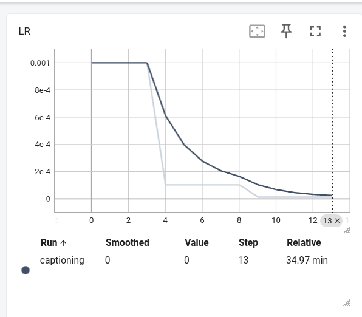
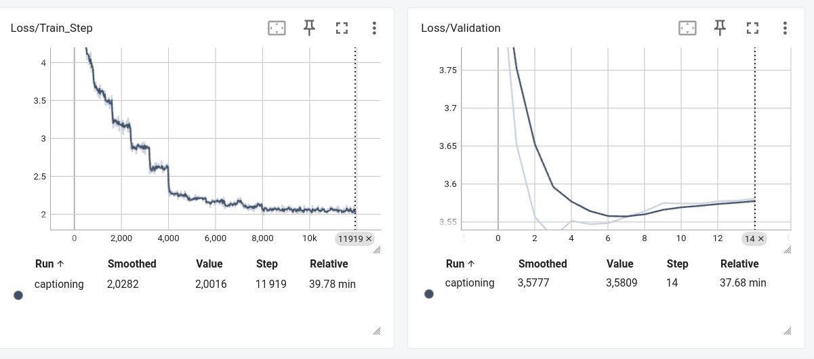
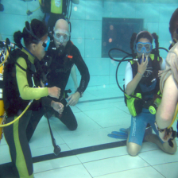

# CI5 : Image Captioning avec RNN et Attention sur ResNet

## Exercice 1 

### Question 1.a 

Pour regrouper les images dans un tenseur, il faut que toutes les images aient la même dimension. 

## Exercice 2 

### Question 1 

requires_grad s'il est à True, il enregistre toutes les opérations mathématiques faites. Ici on ne veut pas enregistrer toutes les opérations pour économiser de la mémoire (VRAM), par ailleurs on utilise les poids de ResNet50 pré-entrainé grâce à cette fonction weights=models.ResNet50_Weights.DEFAULT. 

### Question 2 

La shape exacte du tenseur de sortie sera (32, 2048, 7, 7). 

## Exercice 3 

### Question 3.a

Le context_vector correspond à une synthèse visuelle dynamique et pondérée des zones de l'image sur lesquelles le modèle doit se concentrer pour générer le mot suivant. Le problème de Seq2Seq est qu'on réduit l'image, les nombreuses données associées à un vecteur, et donc on perd beaucoup trop d'information. conctext_vetcor permet de remplacer un résumé figé par un zoom dynamique qui se met à jour à chaque nouveau mot. 

## Exercice 4 

Je l'ai lancé l'entrainement plusieurs fois, je voyais que ça prenait beaucoup de temps. J'ai alors ajouté des affichages pour essayer de trouver pourquoi c'était aussi long chez moi, et j'ai vu que j'utilisais un cpu. j'ai donc réinstallé pytorch avec la version gpu, et cela a fonctionné. J'ai utlisé cette commande :  
pip install --force-reinstall torch torchvision --index-url https://download.pytorch.org/whl/cu121  

### Question 2

Prédiction époque 1 : a men are sitting in in a red pool . one men are one in to in a other  
La syntaxe n'est pas bonne, il répète des mots.  
Prédiction époque 10 : a men are sitting diving in a pool pool with with of and one wearing man , the other  
La syntaxe reste pas bonne.  
Prédiction époque 15 : two men are sitting diving in a pool pool with with of and one wearing man , the other  
Le début de la phrase semble se préciser, mais la syntaxe ne s'améliore pas.  

### Question 3 

  
L'observation des courbes sur TensorBoard  révèle que le modèle ne converge pas idéalement sur l'ensemble de test. La perte d'entraînement (Loss/Train_Step) continue bien de descendre en formant des paliers très nets à chaque diminution du LR, mais la perte de validation (Loss/Validation) atteint son minimum vers l'époque 5 ou 6 (autour de 3.55), puis commence lentement à remonter jusqu'à la fin de l'entraînement. Il y a du surapprentissage.  

Le graphique d'évolution du Learning Rate montre les chutes drastiques du taux d'apprentissage.  

Si nous n'avions pas réduit le learning rate, la courbe de validation serait très probablement remontée de manière beaucoup plus violente et abrupte (surapprentissage accéléré). Les pas de mise à jour des poids étant restés très grands, le modèle aurait continué à osciller fortement, et les phrases générées auraient continué à changer à chaque époque de façon instable. La réduction du LR avec Adam a donc permis d'amortir l'instabilité, mais a fini par "figer" le modèle au moment même où il commençait à surapprendre.

L'image utilisée pour la prédiction est la suivante :  
  